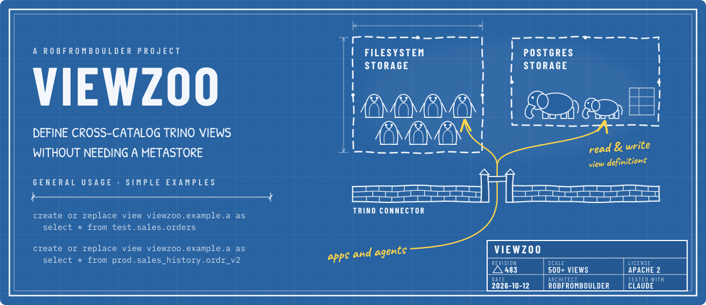

<a href="#"></a>

[](https://claude.ai/code)
[](https://www.codefactor.io/repository/github/robfromboulder/viewzoo)
[](https://github.com/robfromboulder/viewzoo/blob/v483/CONTRIBUTING.md)
[](https://github.com/robfromboulder/viewzoo/blob/v483/LICENSE)

This Trino connector stores views to the local filesystem or a Postgresql database, without requiring Hive metastore or object storage services.

Contents:

* [Dependencies](#dependencies)
* [Installation](#installation)
* [Running With Filesystem Storage](#running-with-filesystem-storage)
* [Running With JDBC Storage](#running-with-jdbc-storage)
* [Using Views](#using-views)
* [Limitations](#limitations)
* [Why ViewZoo?](#why-viewzoo)

> [!NOTE]
> This project is not officially endorsed or supported by Starburst.

## Dependencies

* Trino 483
* Java 25
* Postgresql 10 or higher (optional)
* Maven 3.9.8 or higher (only to build from source)

## Installation

Download Trino 483, and export `TRINO_HOME` as a shell variable:
```bash
export TRINO_HOME=$HOME/Downloads/trino-483
```

Download and install the newest connector release for Trino 483:
```bash
URL=$(curl -fsSL "https://api.github.com/repos/robfromboulder/viewzoo/releases?per_page=100" | grep -o 'https://[^"]*/viewzoo-483[a-z]\.zip' | sort | tail -1) &&
curl -fsSL -o /tmp/viewzoo-483.zip "$URL" &&
rm -rf $TRINO_HOME/plugin/viewzoo && unzip -q /tmp/viewzoo-483.zip -d $TRINO_HOME/plugin && mv $TRINO_HOME/plugin/viewzoo-483 $TRINO_HOME/plugin/viewzoo
```

Or build and install the connector from source:
```bash
mvn clean package && rm -rf $TRINO_HOME/plugin/viewzoo && cp -r ./target/viewzoo-483 $TRINO_HOME/plugin/viewzoo
```

> [!WARNING]
> Don't run Trino yet, you'll need to configure local storage or JDBC storage first.

## Running With Filesystem Storage

Filesystem storage keeps each view as a JSON file in a directory on the Trino server, without requiring any other infrastructure.

Create a local directory to store views:
```bash
rm -rf /tmp/viewzoo && mkdir -p /tmp/viewzoo
```

Create a `$TRINO_HOME/etc/catalog/viewzoo.properties` configuration file like this:
```bash
connector.name=viewzoo
viewzoo.storage_type=filesystem
viewzoo.dir=/tmp/viewzoo
```

Run Trino:
```bash
cd $TRINO_HOME && bash bin/launcher run
```

> [!CAUTION]
> Trino will fail to start if `viewzoo.dir` does not exist, or if Trino doesn't have read and write permissions.

> [!CAUTION]
> If running Trino in a Docker container, ensure `viewzoo.dir` is mapped to a persistent volume or host directory. Without this, view definitions will be lost when the container is upgraded or recreated. To verify your volume mount is configured correctly, run:
> ```bash
> docker inspect <container_name> --format='{{json .Mounts}}' | jq '.[] | select(.Destination == "/path/to/viewzoo.dir")'
> ```
> Replace `/path/to/viewzoo.dir` with your actual `viewzoo.dir` path. If this returns mount information showing a `Source` outside the container, your views are safely persisted. If it returns nothing or shows no external `Source`, your views will be lost on container upgrade.

> [!NOTE]
> Filesystem storage supports Linux and macOS, on a filesystem that supports hard links, which creating and renaming views require; some network and FUSE mounts don't. A crash while writing a view can leave a hidden `.viewzoo-*.tmp` file in `viewzoo.dir`, which is ignored and safe to delete. Each view is stored as a `schema.table.json` file, so it rejects schema or table names containing `/` or a NUL character, names not in Unicode NFC form, and names whose file name would exceed 255 bytes in UTF-8. On a case-insensitive filesystem, it also rejects a view that the filesystem would store in another view's file. On startup, it skips with a warning any `.json` file whose name isn't a lowercase NFC `schema.table.json` or whose contents aren't a view definition. JDBC storage also rejects names containing a NUL character, and on startup skips with a warning any row whose schema or view name is empty or not lowercase, or whose definition isn't a view definition. Both storage types reject schema and table names containing `.` and limit them to 100 characters.

## Running With JDBC Storage

JDBC storage keeps views as rows in one `viewzoo` table of a local or remote Postgres database.

Run a local Postgres server if necessary:
```bash
docker run -d --name viewzoopg -e POSTGRES_PASSWORD=secretpassword -p 5432:5432 postgres:16
```

Create a `$TRINO_HOME/etc/catalog/viewzoo.properties` configuration file like this:
```bash
connector.name=viewzoo
viewzoo.storage_type=jdbc
viewzoo.jdbc_url=jdbc:postgresql://localhost:5432/postgres
viewzoo.jdbc_user=postgres
viewzoo.jdbc_password=secretpassword
```

Run Trino:
```bash
cd $TRINO_HOME && bash bin/launcher run
```

> [!CAUTION]
> Trino will fail to start if Postgres is not running or reachable, or if JDBC authentication fails.

To query the stored definitions from Trino, create a `$TRINO_HOME/etc/catalog/pg.properties` configuration file for the PostgreSQL connector, pointing at the same database:
```bash
connector.name=postgresql
connection-url=jdbc:postgresql://localhost:5432/postgres
connection-user=postgres
connection-password=secretpassword
```

After restarting Trino, list every stored view:
```sql
select schema, view_name from pg.public.viewzoo order by schema, view_name
```

When finished testing, remove local Postgres server:
```bash
docker stop viewzoopg; docker rm viewzoopg
```

## Using Views

Views managed by this connector behave just like regular Trino views, but we'll walk through some simple examples anyway.

Connect your favorite SQL client (like [DBeaver](https://dbeaver.io/) or [Trino CLI](https://trino.io/docs/current/client/cli.html)) to your Trino server.

Create a view with static data:
```sql
create view viewzoo.example.hello as select * from (values ('A', '1')) as t (key, value)
```

Select rows from the view:
```sql
select * from viewzoo.example.hello
```

Show view columns and types:
```sql
describe viewzoo.example.hello
```

Replace view with different static data:
```sql
create or replace view viewzoo.example.hello as select * from (values ('A', '1'), ('B', '4')) as t (key, value)
```

Replace view with query to system catalog:
```sql
create or replace view viewzoo.example.hello as select node_id as key, http_uri as value from system.runtime.nodes
```

Examine current view definition: 
```sql
show create view viewzoo.example.hello
```

Rename the view:
```sql
alter view viewzoo.example.hello rename to viewzoo.example.greeting
```

Delete the view:
```sql
drop view viewzoo.example.greeting
```

## Limitations

> [!CAUTION]
> This connector does not support defining or using tables, only views.

> [!CAUTION]
> Materialized views are not supported. Use Iceberg for view storage in this case.

> [!CAUTION]
> Views are loaded when Trino starts. A view changed outside this connector, such as a file synced from git, a row written to the `viewzoo` table, or a view created by another Trino cluster sharing the same storage, is seen only after Trino restarts.

> [!CAUTION]
> While this connector probably works with multiple versions of Trino, it has only been tested with Trino 483.

## Why ViewZoo?

ViewZoo isn't a replacement for the PostgreSQL connector. ViewZoo uses Postgres to **store** Trino views, but those views can query any catalog.

| Where views are stored | Tradeoffs |
|---|---|
| Memory connector | Views can use any connector, but are lost when Trino restarts. Good performance for a reasonable number of views. It's built into Trino, so there's nothing to install, run or pay for. |
| PostgreSQL connector | The connector can't create Trino views. Native Postgres views are written in Postgres SQL, can only read Postgres tables, and follow Postgres permissions instead of Trino's. Because a native view runs inside Postgres, it suits teams whose data and DBAs are already there. |
| Hive metastore or AWS Glue | A Hive metastore is a service to run, secure and upgrade, and it needs a database of its own. Glue removes that work but ties your view storage to AWS. In return, one metastore can serve Spark, Hive and Trino across a large organization. When it's down, every catalog that depends on it stops. |
| Iceberg JDBC catalog | There's no catalog service to run, and the database can be one you already operate. You also need a warehouse (usually an object store) for Iceberg's metadata files. The two must be backed up together, because the database points at files in the warehouse. |
| Iceberg REST catalog | You need a REST catalog service plus an object store. You either run the catalog yourself, such as Polaris or Lakekeeper, or pay for a managed one. Highest complexity of any option here. In return, large organizations get central access control and short-lived storage credentials, shared by every engine that uses the catalog. |
| ViewZoo (filesystem storage) | You need a directory, which can be a git checkout. Each view is a JSON file, so view definitions become code, with revision history, pull request reviews, and branch-based development. Views are deployed by syncing the directory to the Trino server and restarting Trino. In a container, the directory must be a persistent volume. When the directory is a git checkout, every committed view survives losing the server. |
| ViewZoo (JDBC storage) | You need a Postgres database, where views take one table. Views survive containers being replaced, land in the database's regular backups, and can be listed with SQL, including from Trino through the PostgreSQL connector. A change made by another Trino cluster sharing the table is seen only after a restart. Once Trino is running, views keep working through a Postgres outage, but can't be created or changed until it returns. |

---
<small>&copy; 2024-2026 Rob Dickinson (robfromboulder)</small>
